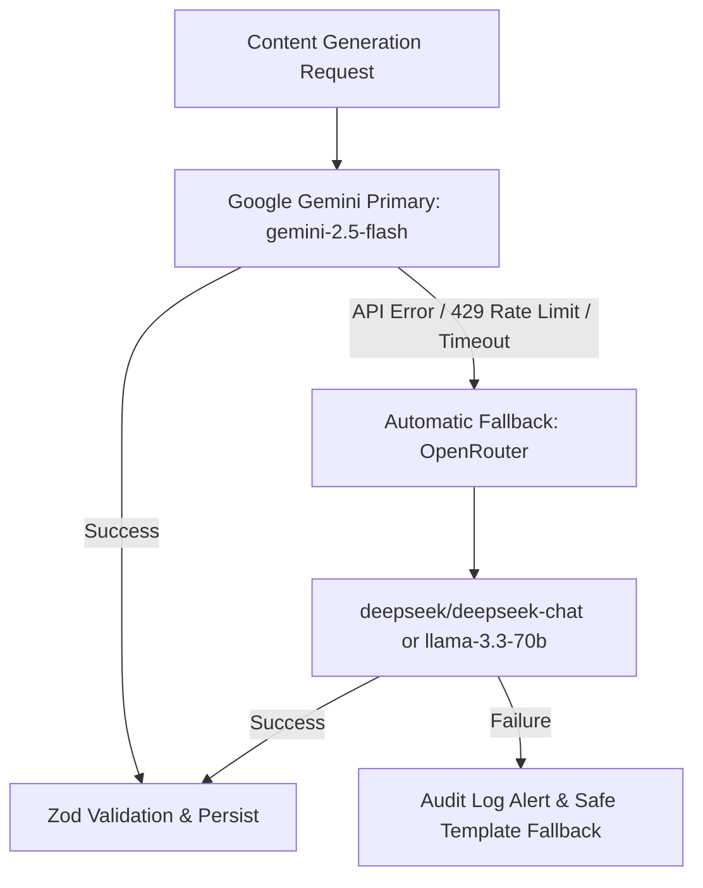

# AI Provider Integration & Fallback Strategy

**The Verdict Room Studio** utilizes a multi-model, provider-independent LLM architecture designed for high availability, zero latency disruptions, and cost tracking.

---

## 1. Provider Hierarchy



### Primary Provider: Google Gemini
- **Model**: `gemini-2.5-flash` (or configurable model).
- **Endpoint**: `https://generativelanguage.googleapis.com/v1beta`
- **Strengths**: Sub-second generation speed, native structured JSON mode, rich cultural context understanding for Indian youth themes.
- **Acquire Key**: Obtain via [Google AI Studio](https://aistudio.google.com).

### Cascade Fallback: OpenRouter
- **Model**: `deepseek/deepseek-chat` or `meta-llama/llama-3.3-70b-instruct`.
- **Endpoint**: `https://openrouter.ai/api/v1/chat/completions`
- **Trigger**: Activates automatically whenever Gemini returns a non-200 status, HTTP 429 rate limit, authentication error, or network timeout.
- **Acquire Key**: Obtain via [OpenRouter.ai](https://openrouter.ai/keys).

---

## 2. Configuration Options

### Option A: Via `.env` File
```ini
GEMINI_API_KEY=AIzaSy...
GEMINI_MODEL=gemini-2.5-flash

OPENROUTER_API_KEY=sk-or-v1-...
OPENROUTER_PRIMARY_MODEL=deepseek/deepseek-chat
OPENROUTER_FALLBACK_MODEL=meta-llama/llama-3.3-70b-instruct
```

### Option B: Via Studio Dashboard
1. Navigate to **AI Provider Settings** in the dashboard sidebar.
2. Edit model names, temperatures, or paste API keys.
3. Click **Test Gemini** or **Test OpenRouter** to verify credentials live with sub-second health checks.
4. Set monthly spending budgets (default: $50/month Gemini, $25/month OpenRouter).

---

## 3. Supported Core Operations

The `AIService` class (`src/lib/services/ai-service.ts`) provides:
1. `generateIdeas({ pillar, format, count })`: Brainstorms fresh dilemma concepts scored for hook clarity, debate potential, and originality.
2. `generateStructuredPost({ premise, pillar, format, isCarousel })`: Produces complete posts with narrative, caption, 4 verdict choices (A/B/C/D), and carousel slides.
3. `rewriteComponent({ componentType, originalText, instructions })`: Re-writes only a specific component (e.g. hook, caption, or slide) without regenerating the entire post.
4. `evaluateQuality({ hook, narrative, caption, format })`: Scores drafts from 1 to 10 against brand voice guidelines.
5. `testConnection(provider, key, model)`: Verifies connectivity.

---

## 4. Cost Logging & Guardrails
Every generation call records prompt tokens, completion tokens, latency in milliseconds, and approximate USD cost in the database `UsageRecord` table.
